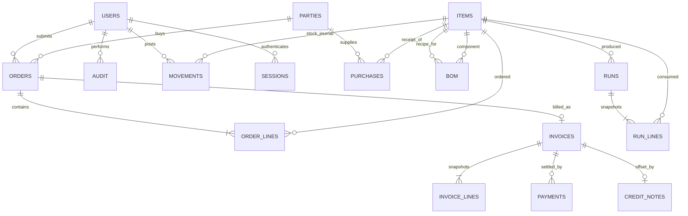

# Batchbook design note

## Data model

Every movement has a dated source document number, such as a receipt, run, invoice, or adjustment. Runs save the yield, planned quantities, scrap, and costs used at posting. Invoices save customer and tax details and retain their original values after a credit note. Users and timestamps are recorded for posting and revisions.

## Stock, recipe, and yield

Quantities are integers in grams, millilitres, pieces, or packets. The service converts kg, litres, and SKU-specific cartons before validation. Current stock is the sum of signed movements. The monthly reconciliation uses opening stock plus receipts minus issues plus adjustments. The ledger calculates a running balance per SKU and orders events by business date and posting ID.

The standard recipe quantity and expected yield are multiplied by the batch count. Actual consumption includes good use and additional scrap. The run, separate use/scrap movements, and good-packet receipt commit together. Variance is `(actual − planned) / planned`. The exact ratio is compared with the configured tolerance, and the displayed percentage is rounded. For an order, availability is on hand minus other approved or invoiced reservations. Dispatch converts that reservation into an issue.

SQLite foreign keys protect references. A serialized write transaction checks stock, payment limits, status transitions, and sequence counters before posting. Requests with the same field-order token and salesperson return the original order. Run overhead revisions use a version number to prevent one edit silently overriding another.

## Valuation and costing

Raw and packaging receipts add quantity and pre-tax inventory value. An issue takes its proportional share of the current value pool, rounded to integer paisa. Moving weighted average blends lots without requiring staff to choose a purchase lot, and subsequent purchases leave previous runs' recorded costs intact. The run includes the purchase value of scrap and attributes its labour, gas/power and other overhead directly to that run. Cost per good packet is total run cost divided by saleable output. Margin per packet is the saved pre-tax list price less that unit cost. Zero-yield runs retain their total cost and display no unit cost or margin.

The prototype files one invoice number sequence per April–March financial year and one separate credit-note sequence. Reports recognise the invoice and any credit on their respective dates. Ageing subtracts recorded receipts and credits through the report cut-off and allocates each open balance by days past its due date.
